<p align="center">
  <picture>
    <source media="(prefers-color-scheme: dark)" srcset="images/tmnas-logo-white.png">
    
  </picture>
</p>

<h1 align="center">TMNAS &times; Harness Software Delivery Workshop</h1>

<p align="center">
  Continuous Integration &bull; DevSecOps &bull; Continuous Delivery &bull; Chaos Engineering &bull; Governance &bull; <b>ServiceNow Change Management</b>
</p>

---

Welcome to the hands-on workshop prepared for **Tokio Marine North America Services (TMNAS)**. Over the following labs you will build an end-to-end delivery pipeline for a sample application, harden it with security scanning, derisk releases with canary deployments, chaos experiments and continuous verification, and finally put it under change control with **policy as code** and **ServiceNow change requests** - exactly the guardrails a regulated insurance business needs, without slowing delivery down.

# Table of Contents

- [Lab 1 - Build](#lab-1---build)
- [Lab 2 - DevSecOps](#lab-2---devsecops)
- [Lab 3 - Continuous Deploy - Frontend](#lab-3---continuous-deploy---frontend)
- [Lab 4 - Continuous Deploy - Backend](#lab-4---continuous-deploy---backend)
- [Lab 5 - Chaos Engineering](#lab-5---chaos-engineering)
- [Lab 6 - Validate Release](#lab-6---validate-release)
- [Lab 7 - Governance & Change Management with ServiceNow](#lab-7---governance--change-management-with-servicenow)
- [Lab 8 - Production Guardrails](#lab-8---production-guardrails)
- [Lab 9 - Enhanced Change Management Automation](#lab-9---enhanced-change-management-automation)
- [Lab 10 - Governance/Policy as Code (Advanced)](#lab-10---governancepolicy-as-code-advanced)
- [Demo - Build in Azure DevOps, Deploy with Harness CD](lab-ado.md)

> **Pre-provisioned for you:** your project already contains a **SNOW Approval** stage template, **ServiceNow Close Ticket**, **ServiceNow Close Failed** and **Change Verified** step templates, and the **Approval Required**, **Production Guardrail** and **Change Verified** policies. They all use the shared `workshop-snow` ServiceNow connector.

---

# Lab 1 - Build

### Summary: Setup a CI Pipeline, including running source code tests, building the executable, building and pushing the artifact to a remote repository

### Outcome: A Deployable artifact

### Learning Objective(s):

- Configure a basic pipeline using Harness CIE

- Build and Deploy an artifact to a remote repository using Harness CIE

- Run unit tests during the process to verify that the build is successful using Harness CIE

**Steps**

1. From the left hand menu, navigate to **Projects** → **Select the project available**

1) From the left hand side menu select **Pipelines**

2) Click **+ Create a Pipeline**, enter the following values, then click **Start**

| Field                                  | Value            | Notes
| -------------------------------------- | ---------------- | ------------------------------------------------------------------------------------------ |
| Name                                   |workshop|                                                                                            |
| How do you want to setup your pipeline |Inline| This indicates that Harness (rather than Git) will be the source of truth for the pipeline |

3. From Pipeline Studio, Click **Add Stage** and select **Build** as the Stage Type

4. Enter the following values and click on **Set Up Stage**


| Input           | Value           | Notes |
| --------------- | --------------- | ----- |
| Stage Name      |Build|       |
| Clone Codebase  |Enabled|       |
| Repository Name |harnessrepo|       |

5. There are two main tabs that need configuration:\
   **Infrastructure**


| Input          | Value | Notes |
| -------------- | ----- | ----- |
| Infrastructure |Cloud|       |

**Execution**

- Select **Add Step**, then **Add Step** again, then select **Test Intelligence** from the Step Library and configure with the following


| Input                        | Value                                      | Notes                                                                                                                                             |
| ---------------------------- | ------------------------------------------ | ------------------------------------------------------------------------------------------------------------------------------------------------- |
| Name                         |Run Tests With Intelligence|                                                                                                                                                   |                                   |
| Command                  |pip install pytest & cd ./python-tests| The github repo is a monorepo with application(s) and configuration in the same repo. Therefore we need to navigate to the application subfolder. |                                                                                                                 |


- After completing configuration select **Apply Changes** from the top right of the configuration popup

- Select **Add Step**, then **Use template** (In this step we will be building the binary following same config as before. To avoid duplication of efforts a template has been precreated)


| Input         | Value               | Notes |
| ------------- | ------------------- | ----- |
| Template Name |Compile Application|       |

- Select the  template and press **Use Template,** then provide a name for that template


| Input | Value   | Notes |
| ----- | ------- | ----- |
| Name  |Compile|       |

- Select **Add Step**, then **Add Step** again, then select **Build and Push an image to Docker Registry** from the Step Library and configure with the following


| Input             | Value                                               | Notes                                                                    |
| ----------------- | --------------------------------------------------- | ------------------------------------------------------------------------ |
| Name              |Push to DockerHub|                                                                          |
| Docker Connector  |dockerhub| Select the **Third-Party Artifact Registry** tab to find it              |
| Docker Repository |nikpap/harness-workshop|                                                                          |
| Tags              |<+variable.username>-<+pipeline.sequenceId>| This will be the tag of the image using harness expressions. Click on the pin and select expression and paste the value              |
| **Optional  Configuration** |                                            |                                                                                                                                                   |
| Dockerfile        |/harness/frontend-app/harness-webapp/Dockerfile| This tells harness where is the Dockerfile for building the app          |
| Context           |/harness/frontend-app/harness-webapp| This tells from where to run the instructions included in the dockerfile |

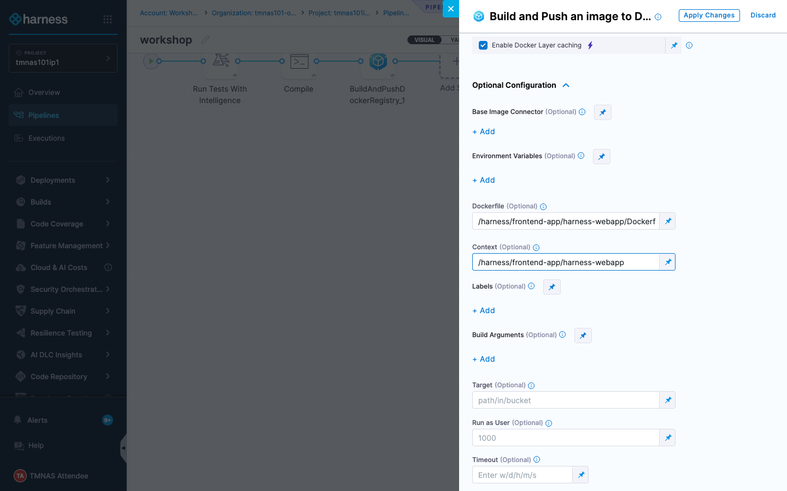

1. Click **Apply Changes** to close the config dialog

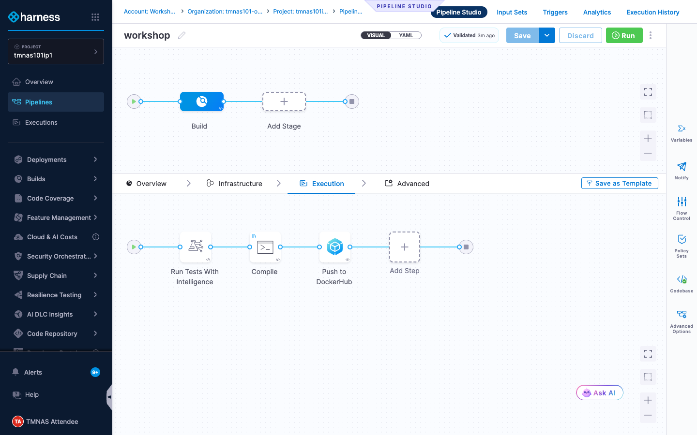

6) Click **Save** and then click **Run** to execute the pipeline with the following inputs


| Input       | Value | Notes        |
| ----------- | ----- | ------------ |
| Branch Name |main| prepopulated |

7) The execution is stopped before it starts. Your security team's organisation policy (**tmnas101-secops**) requires the Fortify and OWASP scans in every pipeline. Failure is success - you will fix it in Lab 2.

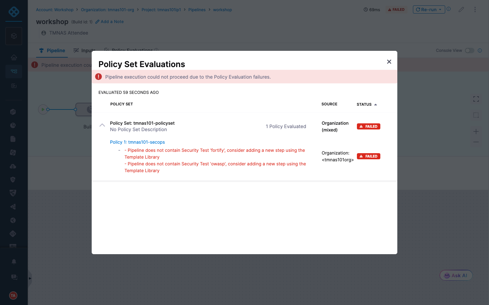


# Lab 2 - DevSecOps

**Summary:** Our security team has implemented orchestration of **Fortify** and **OWASP** scans for our code in a reusable form **(templates)**. In order to improve our security posture they have also added policies to enforce us to include those templates

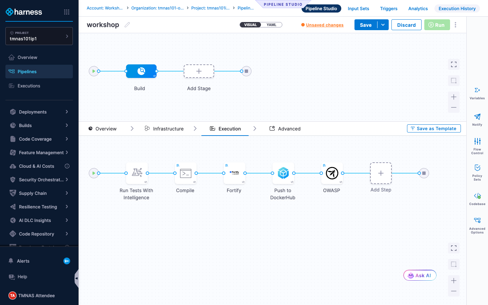

**Learning Objective(s):**

- Understand how governance plays a role in the path to production

- Reusable templates make developer’s life easier

- DevSecOps practices can be easily achieved

**Steps**

1. In the existing pipeline, within the Build stage **before** PushToDockerhub step click on the plus icon to add a new step

2. Select **Use template**\
   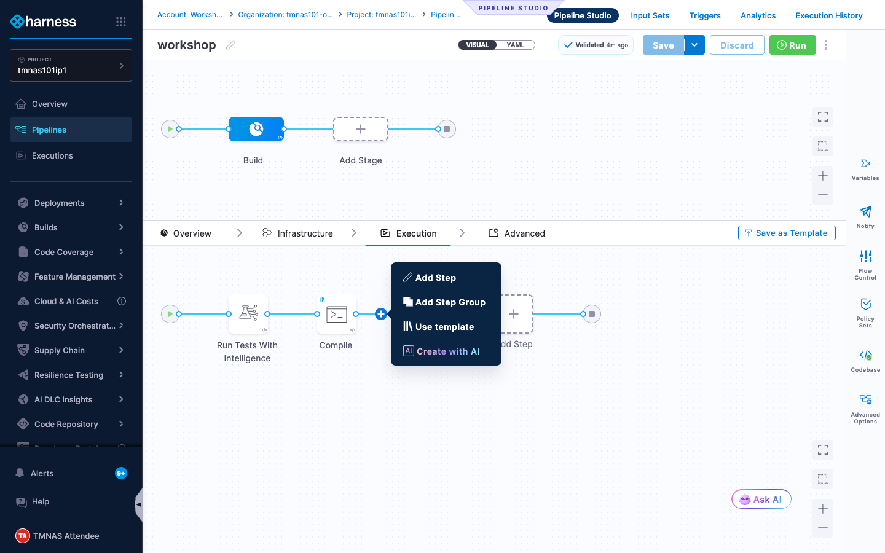

3. Select **Devx Fortify Scan - DAST**

   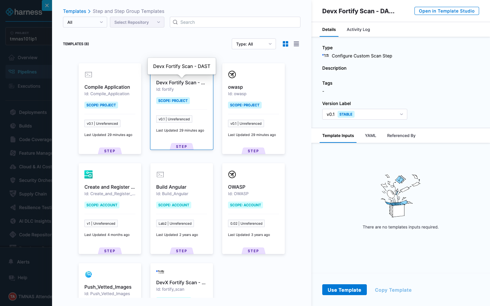

4. Name the step **Fortify**

5. In the existing pipeline, within the Build stage **after** PushToDockerhub step click on the plus icon to add a new step

6. Select use template

7. Select **owasp**

8. Name the step **OWASP**

9. Click **Save** and then click **Run** to execute the pipeline with the following inputs


| Input       | Value | Notes |
| ----------- | ----- | ----- |
| Branch Name |main|       |

This time the security policy passes and the build runs. After the **Build** stage is complete, go to the **Vulnerabilities** tab to see the deduplicated, normalized and prioritized list of vulnerabilities discovered across your scanners.

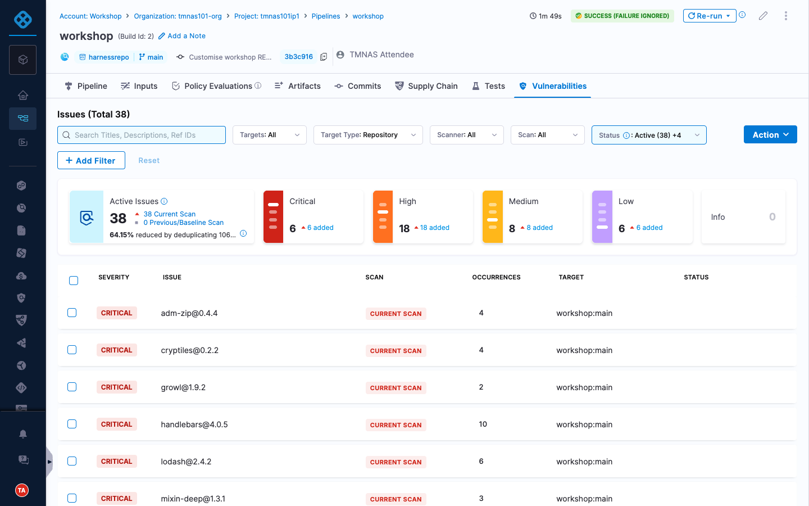


# Lab 3 - Continuous Deploy - Frontend

### Summary: Extend your existing pipeline to take the artifact built in the CI/Build stage and deploy it to an environment

**Learning Objective(s):**

- Add a second stage to an existing pipeline

- Create a k8s service

- Incorporate an advanced deployment strategy such as Canary

- Create custom Harness variables

- Create an Input Set

**Steps**

2. In the existing pipeline, add a Deployment stage by clicking **Add Stage** and select **Deploy** as the Stage Type

3. Enter the following values and click on **Set Up Stage**


| Input           | Value          | Notes |
| --------------- | -------------- | ----- |
| Stage Name      |frontend|       |
| Deployment Type |Kubernetes|       |

4. Configure the **frontend** Stage with the following\
   **Service**

- Click **+Add Service** and configure as follows****


| Input                      | Value                                               | Notes                              |
| -------------------------- | --------------------------------------------------- | ---------------------------------- |
| Name                       |frontend|                                    |
| Deployment Type            |Kubernetes|                                    |
| * **Add Manifest**         |                                                     |                                    |
| Manifest Type              |K8s Manifest|                                    |
| K8s Manifest Store         |Code|                                    |
| Manifest Identifier        |templates|                                    |
| Repository                 |harnessrepo|                                    |
| Branch                     |main|                                    |
| File/Folder Path           |harness-deploy/frontend/manifests|                                    |
| Values.yaml                |harness-deploy/frontend/values.yaml|                                    |
| - **Add Artifact Source**  |                                                     |                                    |
| Artifact Repository Type   |Docker Registry|                                    |
| Docker Registry Connector  |dockerhub|                                    |
| Artifact Source Identifier |frontend|                                    |
| Image Path                 |nikpap/harness-workshop|                                    |
| Tag                        |<+variable.username>-<+pipeline.sequenceId>| Select value, then click on the pin and select expression and paste the value |

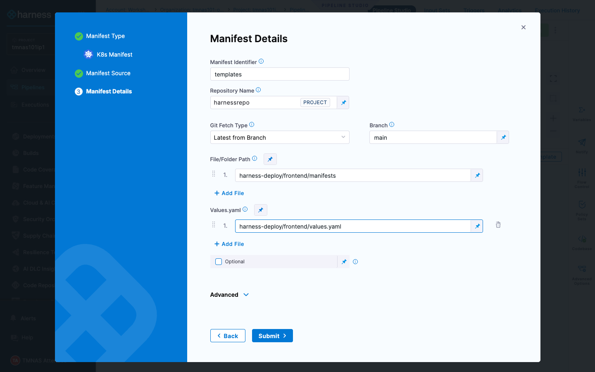
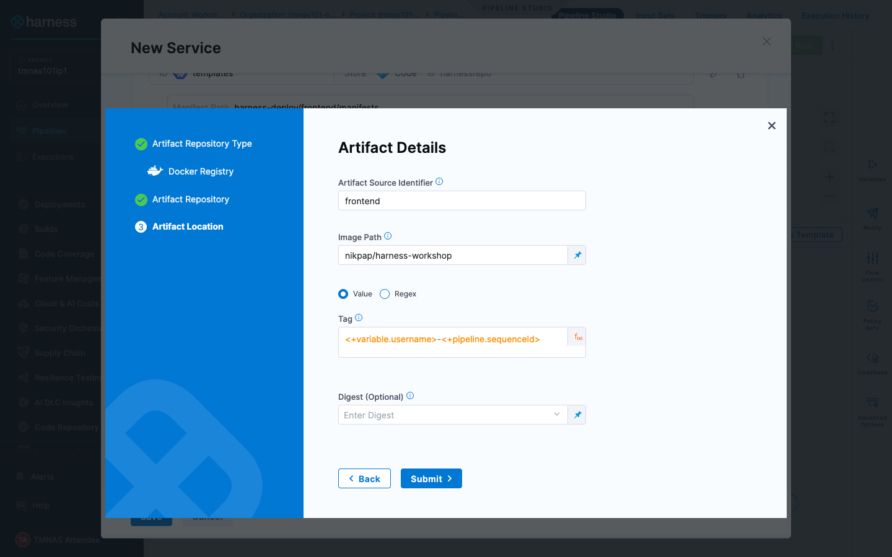
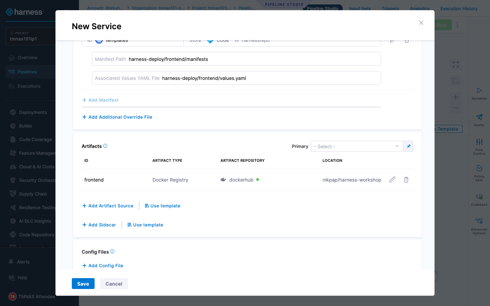

- Click **Save** to close the service window and then click **Continue** to go to the Environment tab

**Environment**

The target infrastructure has been pre-created for us. The application will be deployed to a k8s cluster on the given namespace  

- Click **- Select -** on the **"Specify Environment"** input box 

- Select **prod** environment and click **"Apply Selected"**

| Input | Value | Notes                                                             |
| ----- | ----- | ----------------------------------------------------------------- |
| Name  |prod| Make sure to select the environment and infrastructure definition |

- Click **- Select -** on the **"Specify Infrastructure"** input box

-  From the dropdown select k8s


| Input | Value | Notes |
| ----- | ----- | ----- |
| Name  |k8s|       |

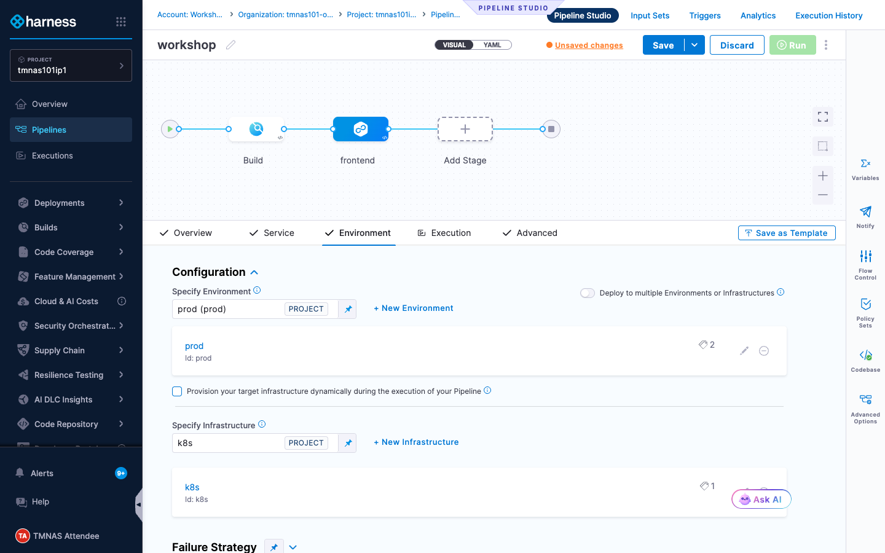

- Click **Continue**

**Execution Strategies**

- Select **Rolling** and click on **Use Strategy**, the frontend is a static application so no need to do canary.

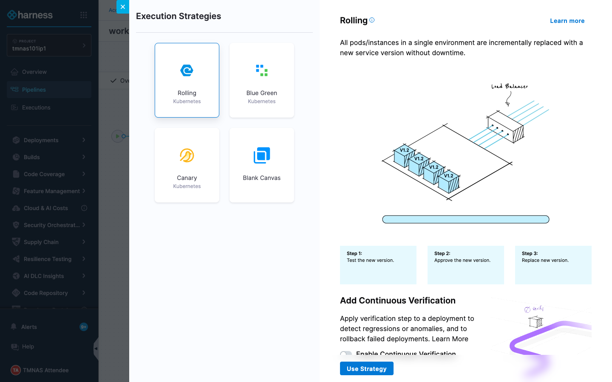


# Lab 4 - Continuous Deploy - Backend

### Summary: Extend your existing pipeline to derisk production deployments

**Learning Objective(s):**

- Utilise complex deployment strategies to reduce blast radius of a release 

**Steps**

5. In the existing pipeline, add a Deployment stage by clicking **Add Stage** and select **Deploy** as the Stage Type

6. Enter the following values and click on **Set Up Stage**


| Input           | Value          | Notes |
| --------------- | -------------- | ----- |
| Stage Name      |backend|       |
| Deployment Type |Kubernetes|       |

7. Configure the **backend** Stage with the following\
   **Service**

- Click **- Select -**  on the **"Select Service"** input box and configure as follows:


| Input | Value       | Notes |
| ----- | ----------- | ----- |
| Name  |backend|       |

- Click **Apply Selected** and then click **Continue** to go to the **"Environment"** tab

**Environment**

The target infrastructure has been pre-created for us and we used it in the previous stage. To reuse the same environment

- Click **- Propagate Environment From**

- Select **Stage \[frontend]**

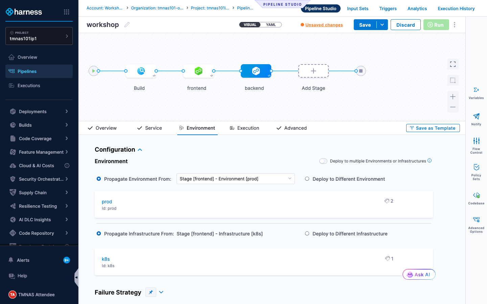

- Click **Continue**

**Execution**

- Select **Canary** and click on **Use Strategy**

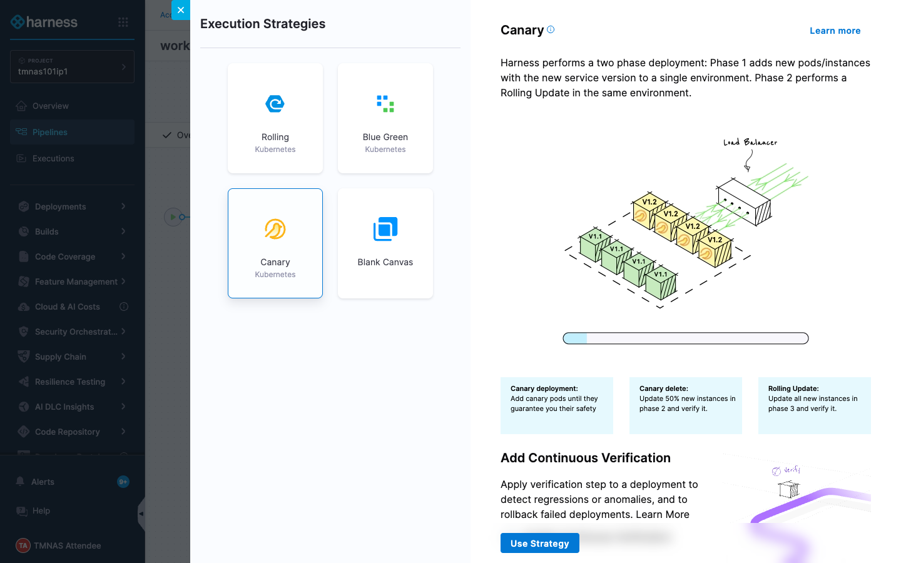

- **After** the canary deployment and **before** the canary delete step add **Harness Approval** step according to the table  below

| Input       | Value             | Notes |
| ----------- | ----------------- | ----- |
| Name        |Approval|       |
| User Groups |All Project Users| Select the **Project** tab to see the **"All Project Users"** option |

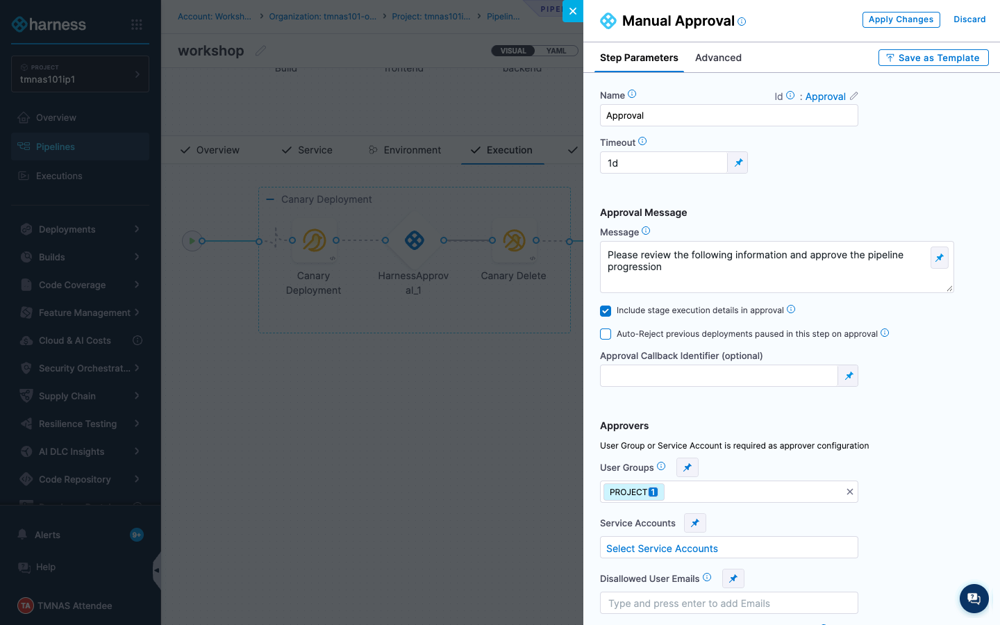
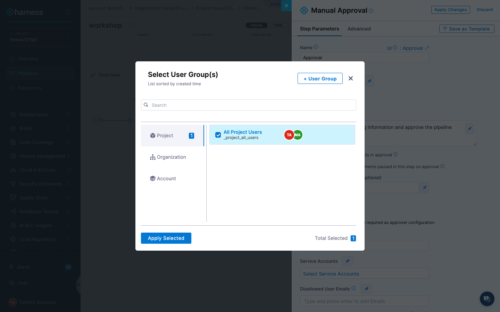

- Click **Apply Changes**

8. Click **Save** and then click **Run** to execute the pipeline with the following inputs. As a bonus, save your inputs as an Input Set before executing (see below)

| Input       | Value | Notes       |
| ----------- | ----- | ----------- |
| Branch Name |main| Leave as is |

The artifact tags for **frontend** and **backend** are already filled in from the service definitions.

9. While the canary deployment is ongoing and waiting **approval** navigate to the web page and see if you can spot the canary (use the check release button) 

| project                | domain        | suffix |
| ---------------------- | ------------- | ------ |
|http\://project_id|.cie-bootcamp|.co.uk|

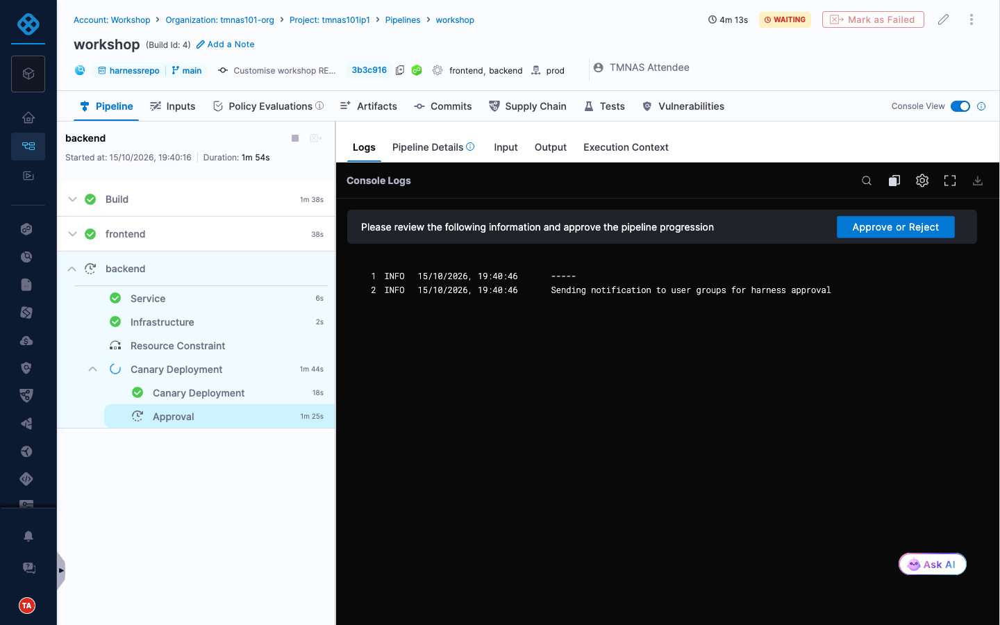
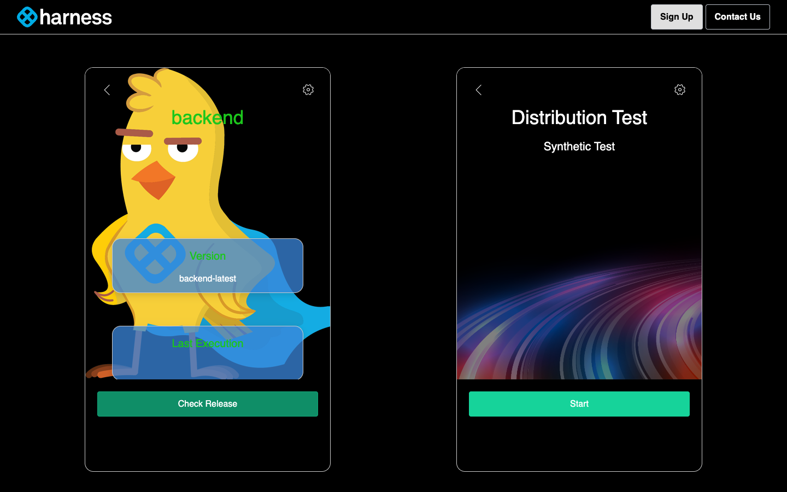

10. Approve the canary deployment for the pipeline to complete

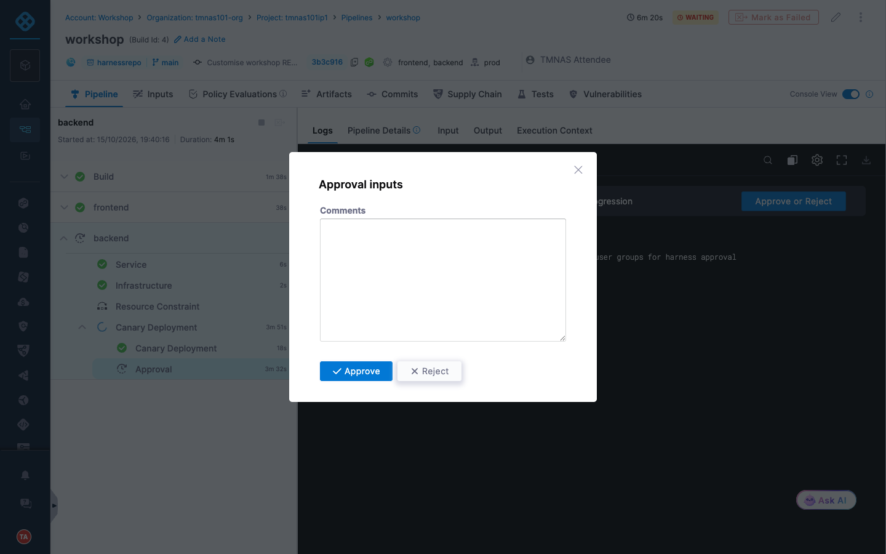
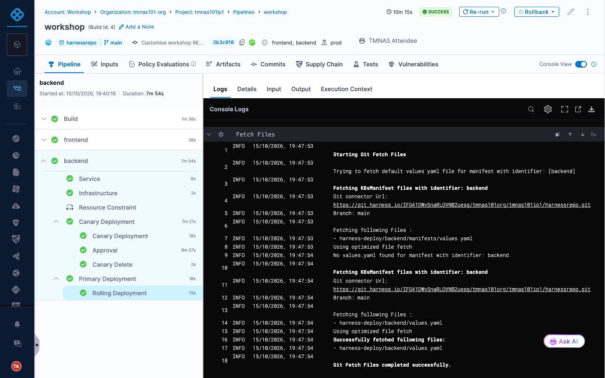

# Lab 5 - Chaos Engineering


### Summary: Fully integrated chaos experiments with the delivery process

> **Prerequisite:** this lab needs Harness Chaos Engineering enabled for your project and a chaos infrastructure connected to the `prod` / `k8s` environment. Your instructor will confirm whether it is available for your session; Labs 6-10 do not depend on it.

**Learning Objective(s):**

- Auto generate chaos experiments on deployed services
- Build a chaos experiments using a base fault (out of 200 OOTB faults)
- Embed chaos engineering experiments into the deployment process
- Add continuous verification to the deployed service
- Automate release validation

**Steps**

1. From the module selection menu select **resilience testing**


4. From the left hand menu, go to **Project Settings**
5. From the available tiles select “Discovery”
6. After expanding the side menu of the “DA-K8s” agent click on “Discover Now”

  


**Create Application Map**

1. After discovery is complete double click on the agent “DA-K8s”

   


1. Select the "Application Maps" tab
2. Click on **Create New Application Map** and enter the following values

| Input                        | Value|  
| ---------------------------- | ------ |
| Name                         |workshop-am|

4. Select the relevant services for your project name "use the search function to find the services"
5. Click Save


**Auto Generate Chaos Experiments**
1. From left handside menu select **Resilience Management**
2. Drill down to the previously created application map
3. Navigate to **Chaos Experiments**
4. Select **Only a few**

Observe the auto generated experiments and run the **web-backend experiment**


---------------

**Create Experiments manually**

This time we will create a network corruption experiment

1. From the left hand menu, go to **Chaos Testing**
2. Select **+New Experiment**

| Input                        | Value|  
| ---------------------------- | ------ |
| Name                         |network-corruption|

3. Select **Harness Infra**

  

  - Click on **"Select a chaos Infrastructure"**

 
4. On the popup window select the available options

| Input                        | Value|  
| ---------------------------- | ------ |
| Select Environment|prod|
| Select Infrastructure|k8s|

5. Click on next to navigate to the experiment builder
6. Click on **Add Fault**
7. From the list of available faults select **Pod Network Corruption**
8. From the navigation bar select **Target Application**

| Input                        | Value | Notes |
| ---------------------------- | ------ | -------|
| Target Workload Kind|deployment||
| Target Workload Namespace ||**Select the namespace available from the dropdown**|
| Target Workload Names | Pick the backend deployment name|We will change that later |
|Target Workload Labels | leave empty||


9. From the navigation bar select **Tune Fault**

| Input       | Value |
| ----------- | ----- |
| Total Chaos Duration |150|
| Network Packet Corruption Percentage |100|
10. Click on **Apply Changes** and then **Save**
11. Run the experiment and observe the logs. 
12. While the experiment is running navigate to the application's endpoint (see image below)
13. Observe the network errors

| project                | domain        | suffix |
| ---------------------- | ------------- | ------ |
| http\://\<project\_id>|.cie-bootcamp|.co.uk|


**Validate the health automatically**

1. From the left hand menu, go to **Project Settings**
2. Select **Chaos Probles**
3. Create a new probe by clicking **+ New Probe**
4. Select the HTTP probe
   
| Field                | Value        | Notes |
| ---------------------- | ------------- | ------ |
| http\://\<project\_id>.cie-bootcamp.co.uk |||
| Criteria | == | | 
| Response Code | 200 | | 

5. Move to the next tab **Configure Properties**


| Field                | Value        | Notes |
| ---------------------- | ------------- | ------ |
| Timeout | 20s ||
| Interval | 2s | | 
| Attempt | 5 | | 
| Initial Delay | 5s ||

Now that we have our probe navigate to **Chaos Testing**
Drill down to the **network-latency** experiment

Hovering over the network fault we can add our newly created probe 
Select **+ Add a parallel node -> Add a probe**


Save and rerun the experiment 
Observe the **logs** of the probe **Resilience Score** generated in comparisson to the previous execution


---------------

**Create Experiments manually**

1. From the left hand menu, go to **Chaos Testing**
2. Select **+New Experiment**

| Input                        | Value|  
| ---------------------------- | ------ |
| Name                         |pod-memory|

3. Select **Harness Infra**

  

  - Click on **"Select a chaos Infrastructure"**

 
4. On the popup window select the available options

| Input                        | Value|  
| ---------------------------- | ------ |
| Select Environment|prod|
| Select Infrastructure|k8s|

5. Click on next to navigate to the experiment builder
6. Click on **Add Fault**
7. From the list of available faults select **Pod Memory Hog**
8. From the navigation bar select **Target Application**

| Input                        | Value | Notes |
| ---------------------------- | ------ | -------|
| Target Workload Kind|deployment||
| Target Workload Namespace ||**Select the namespace available from the dropdown**|
| Target Workload Names | Pick the backend deployment name|We will change that later |
|Target Workload Labels | leave empty||


9. From the navigation bar select **Tune Fault**

| Input       | Value |
| ----------- | ----- |
| Total Chaos Duration |600|
| Memory Consumption |300|
| Number of workers |1|
| Pod affected percentage|100|

10. Click on **Apply Changes** and then **Save**


**Change target service to canary using YAML**

1. From the pipeline visual editor switch to yaml
2. Click the edit button to go into edit mode
3. Locate the service name (set on previous state) **TARGET_WORKLOAD_NAMES**
4. Replace it with **backend-<project_name>-deployment-canary** where project_name is the harness project. Summary: add the suffic **-canary** to the target workload
5. Save the experiment


**Embed chaos experiments into CD pipelines**

1. From the module selection menu select Continuous Delivery & GitOps


   

   
2. From the left hand side menu select pipelines and drill down to the existing pipeline

3. In the existing pipeline, within the Deploy backend stage **after** Canary Deployment and **before** the approval step click on the plus icon to add a new step

4. Add a **Verify** step with the following configuration

| Input                        | Value  | Notes                                                                                            |
| ---------------------------- | ------ | ------------------------------------------------------------------------------------------------ |
| Name                         |Verify|                                                                                                  |
| Continuous Verification Type |Canary|                                                                                                  |
| Sensitivity                  |Low| This is to define how sensitive the ML algorithms are going to be on deviation from the baseline |
| Duration                     |10mins|                                                                                                  |

5. Under the verify step click on the plus icon to add a new step in parallel


   

   
6. Add a **chaos** step with the following configuration

| Input                        | Value  |
| ---------------------------- | ------ |
| Name                         |Chaos|
| Select Chaos Experiment |pod-memory|
|  Expected Resilience Score|50| 

7. Click on Apply Changes

8. Click **Save** and then click **Run** to execute the pipeline with the following inputs.

| Input       | Value | Notes       |
| ----------- | ----- | ----------- |
| Branch Name |main| Leave as is |

9. After 10 minutes review what happened with the execution 

# Lab 6 - Validate Release

**Learning Objective(s):**

- Identify the difference in traffic between normal and canary instances of the application

- Automate release validation

- Use complex deployment strategies to reduce the blast radius

**Outcomes**
- Force failure of continuous delivery validation using chaos engineering

**Steps**:

- Run the pipeline and, while the backend canary is waiting for **approval**, navigate to the web page (use the **Check Release** button)

| project                | domain        | suffix |
| ---------------------- | ------------- | ------ |
| http\://\<project\_id>|.cie-bootcamp|.co.uk|

> **Note:** the canary runs the same `backend-latest` image as the primary, so **Check Release** shows the same version on every call. The Distribution Test is how you spot the canary.


- Drill down to the **Distribution Test** tab, click **Start** and then click the **play** icon to generate traffic

- Observe the traffic distribution between the **normal** and **canary** instances

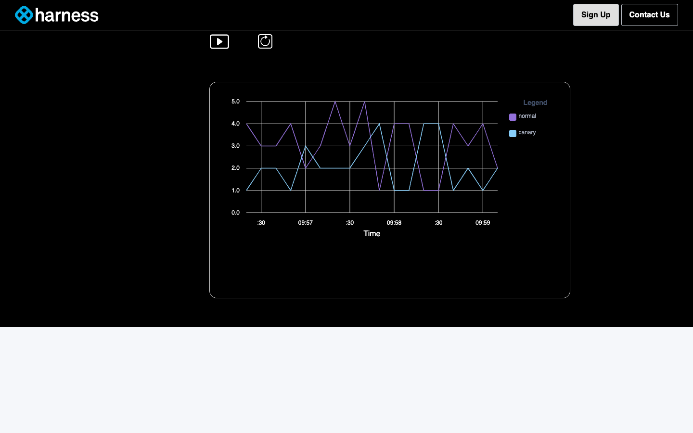

- Validate the outcome of the verification on the pipeline execution details, then approve the canary

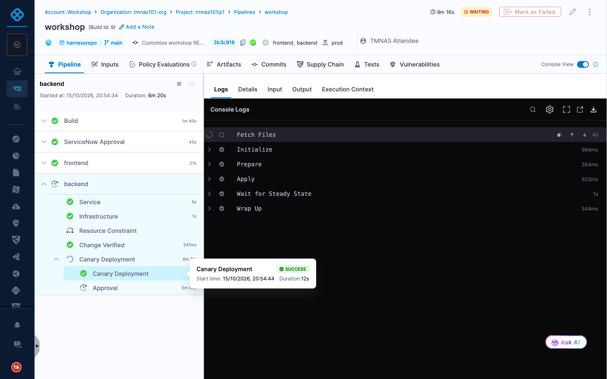

**Bonus**:
- If the verification fails harness defaults to a manual intervention, you can now decide what you want to happen next (rollback, ignore etc.) 

- Add a canary rollout from 10% to 50% traffic and see how this impacts the traffic distribution


# Lab 7 - Governance & Change Management with ServiceNow

### Summary: Your pipeline builds, tests, scans and deploys the frontend and backend. Now the change advisory board wants a word. In regulated environments you can't ship to production without following change policy and keeping an audit trail. In this lab you will enforce an approval gate with Policy as Code and integrate ServiceNow so change requests are raised, approved and closed automatically by the pipeline. Compliance as code, not compliance as a bottleneck.

**Learning Objective(s):**

- Enforce governance guardrails using Policy as Code (OPA)

- Automatically create a ServiceNow change request populated with pipeline metadata

- Gate production deployments on a ServiceNow approval

- Close the change request automatically once the release succeeds

**Why it matters:** Governance doesn't have to be manual, inconsistent or slow. Every pipeline follows the same change process, every release leaves an auditable trail in ServiceNow, and developers never have to fill in a change form by hand.

**Steps**

**Policy as Code**

1. From the secondary menu, select **Project Settings** and select **Policies**

2. Select the **Policies** tab, open **Approval Required Policy** and review the rego. It denies any pipeline where a **Deployment** stage is not preceded by an **Approval** stage

3. Click **Select Input** on the right and select the following values

| Input        | Value              | Notes |
| ------------ | ------------------ | ----- |
| Entity Type  |Pipeline|       |
| Organization |\<your-org>|       |
| Project      |\<your-project>|       |
| Action       |On Save|       |

4. Select your most recent pipeline save, click **Apply** and then click **Test**. What do you think will happen?

> **Note:** The Harness Approval step we added inside the backend stage in Lab 4 is not enough - change policy requires an approval **before** any deployment stage, so the test fails. Failure is success, the policy is working as designed.


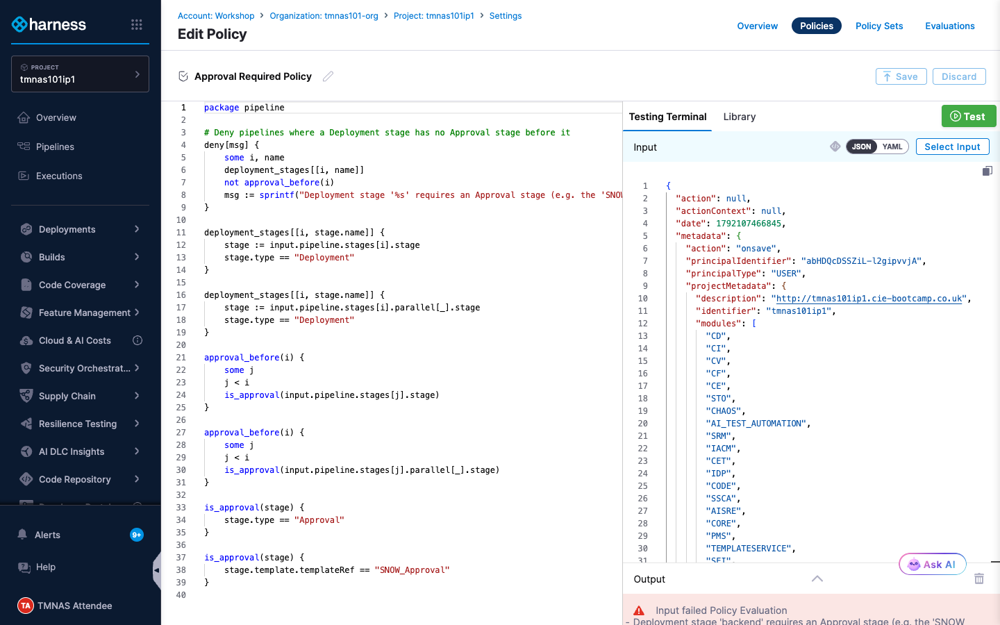

5. Select the **Policy Sets** tab, find **Approval Required Policy Set** and toggle **Enforced** on


**Governance in Action**

1. Open your pipeline in Pipeline Studio

2. Make a small change (for example, add a tag to the pipeline) and click **Save**

3. Note that the save is blocked by the **Approval Required Policy**. Let's fix it!


**Approvals via ServiceNow Change Requests**

1. Hover before the **frontend** stage and click the **+** icon to add a new stage

2. Click **Use template**, select the **SNOW Approval** template and click **Use Template**

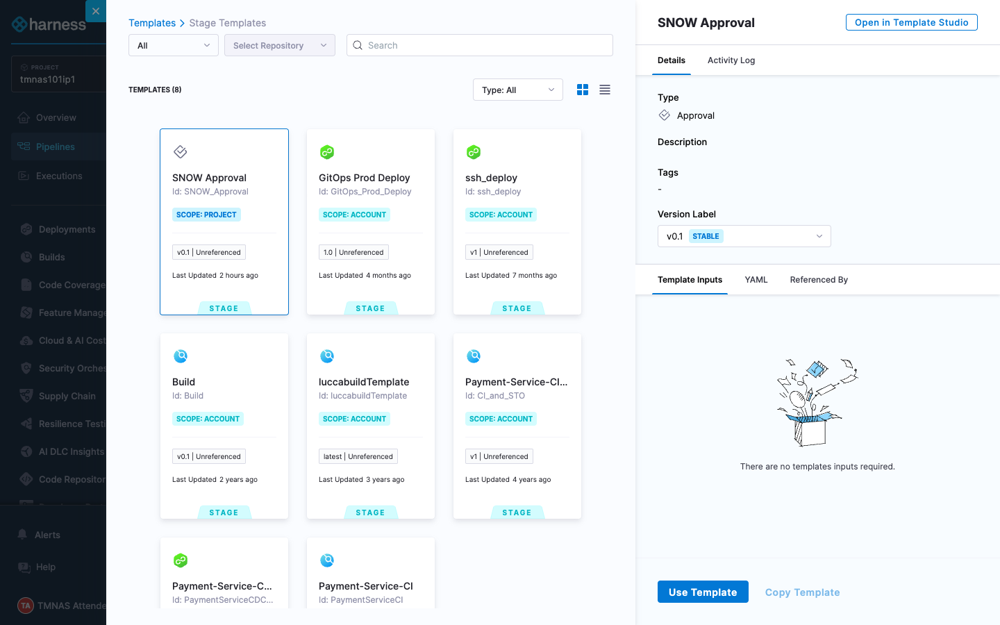

3. Configure the stage as follows and click **Set Up Stage**

| Input      | Value               | Notes |
| ---------- | ------------------- | ----- |
| Stage Name |ServiceNow Approval| The name must match exactly - the close templates reference this stage to find the change number |


4. The template is pre-configured, so there are no inputs to fill in. Toggle **Overview** to see its two steps

| Step          | Type               | What it does |
| ------------- | ------------------ | ------------ |
| Create Ticket |ServiceNow Create| Raises a Normal change request with the pipeline name, execution number, triggering user, execution URL, justification, implementation, backout and test plans |
| Approval      |ServiceNow Approval| Polls the change request every 30s. Approves when **State = Implement**, rejects when **State = Canceled** |

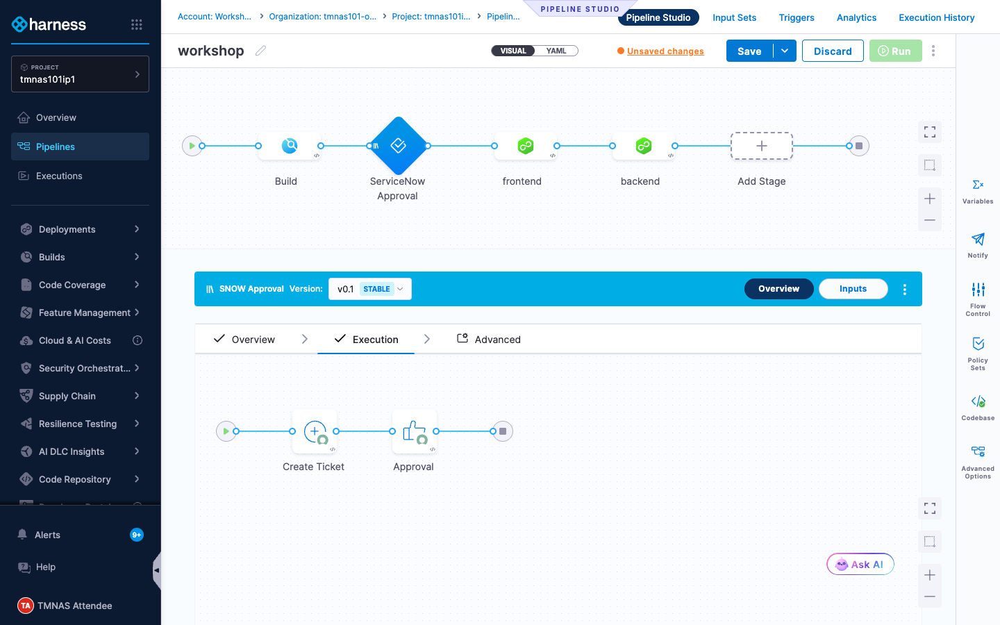

5. Click on each step to see how it is configured. As a template user you cannot change the configuration of this enterprise-approved template - only the template administrator can. Note how Harness expressions such as `<+pipeline.executionUrl>` and `<+execution.steps.Create_Ticket.ticket.ticketNumber>` dynamically populate the ticket and the approval

6. Navigate to the **backend** stage and, after the last step of the execution, click **Add Step**, select **Use template** and choose **ServiceNow Close Ticket**

| Input | Value        | Notes |
| ----- | ------------ | ----- |
| Name  |Close Ticket| Sets the change to **Closed** with close code **Successful** and links the execution in the close notes |

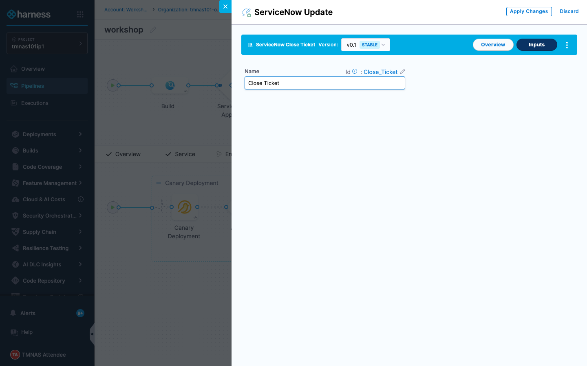

7. Click **Save**. No violations this time - hooray for compliance!


**Approve the change as a Release Manager**

1. Click **Run** to execute the pipeline

| Input       | Value | Notes       |
| ----------- | ----- | ----------- |
| Branch Name |main| Leave as is |

2. The pipeline pauses on the **ServiceNow Approval** stage. The pipeline has already raised the change request on your behalf and moved it to **Scheduled** - no manual change records for the developer to maintain


3. Click the **ServiceNow Approval** stage, select the **Approval** step and click the change number link in the step details to open the change request in a new tab

4. Log in to the ServiceNow sandbox with the credentials provided by your instructor. Review the metadata the pipeline added to the change, then click **Implement** in the top right corner


5. Switch back to Harness and watch the pipeline continue once the approval criteria are met. When the backend stage completes, the **Close Ticket** step closes the change as **Successful**

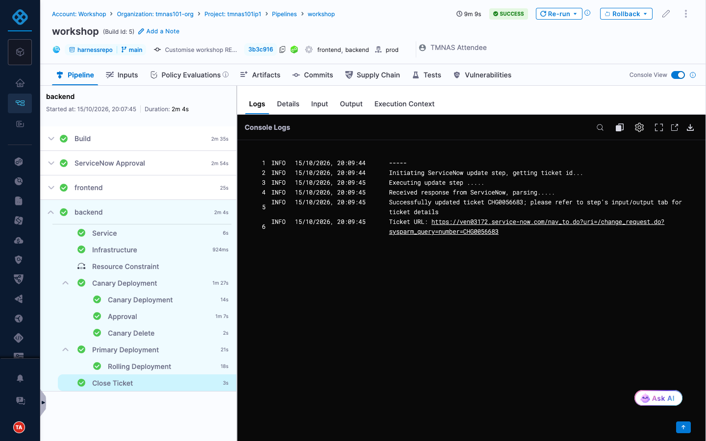
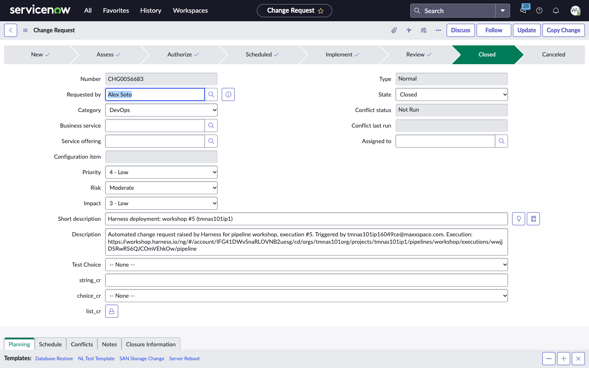

**Bonus**:
- Run the pipeline again and this time **Cancel** the change in ServiceNow. Observe how the pipeline is rejected before anything is deployed to production
- What happens to the change if the release fails after it was approved? See [Lab 9](#lab-9---enhanced-change-management-automation)

# Lab 8 - Production Guardrails

### Summary: An approval stage at the front of the pipeline is a good start, but production is special. In this lab you will enforce a policy that says *any deployment to the **prod** environment, or of the **backend** service, must include a policy check*, and then add a **Change Verified** policy step that confirms at runtime that the release is backed by an approved ServiceNow change.

**Learning Objective(s):**

- Write guardrails that target specific environments and services

- Combine design-time (**On Save**) and runtime (**On Step**) policies

- Use a Policy step to verify ServiceNow change details right before a production rollout

**Why it matters:** The **Approval Required** policy checks the shape of the pipeline. The **Production Guardrail** policy goes further: nobody can create or edit a pipeline that deploys to production, or deploys the backend, without a policy check in that stage. And the **Change Verified** step proves - immediately before the rollout - that the change number is real and its approval succeeded. The evidence is stored with the execution for auditors.

**Steps**

**Enforce the Production Guardrail**

1. From the secondary menu, select **Project Settings** and select **Policies**

2. Select the **Policies** tab and open **Production Guardrail Policy**. Review the rego:

| Rule | What it does |
| ---- | ------------ |
| `protected_environments := {"prod"}` | Environments that need a policy check |
| `protected_services := {"backend"}` | Services that need a policy check, in any environment |
| `deny[msg]` | Fails any Deployment stage that targets a protected environment or service and has no step of type **Policy** |

3. Select the **Policy Sets** tab, find **Production Guardrail Policy Set** and toggle **Enforced** on

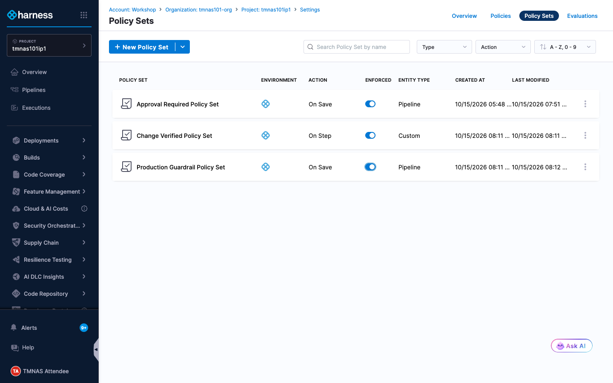

4. Open your pipeline in Pipeline Studio, make a small change and click **Save**. The save is blocked for **both** stages - frontend deploys to **prod**, and backend is a protected service


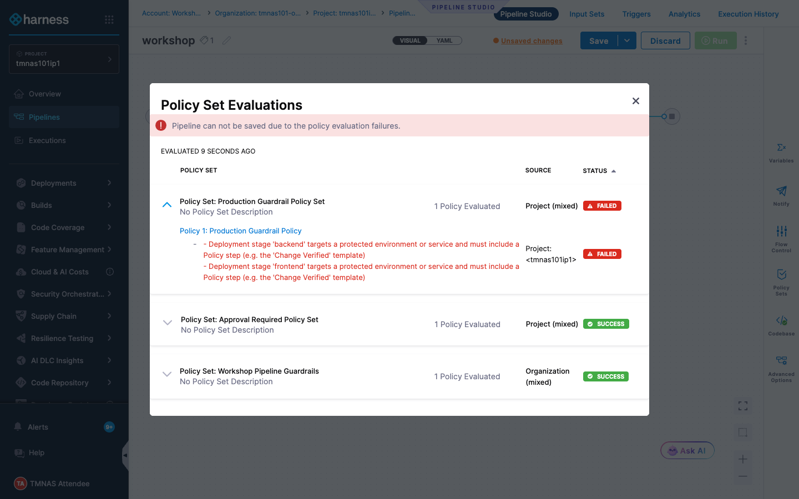

**Add the Change Verified step**

The **Change Verified** step template is a **Policy** step that evaluates the **Change Verified Policy Set** (On Step) with this payload:

```json
{
  "changeNumber": "<+pipeline.stages.ServiceNow_Approval.spec.execution.steps.Create_Ticket.ticket.ticketNumber>",
  "approvalStatus": "<+pipeline.stages.ServiceNow_Approval.status>",
  "environment": "<+env.identifier>",
  "service": "<+service.identifier>"
}
```

The **Change Verified Policy** denies the step if the change number doesn't start with `CHG`, or if the ServiceNow Approval stage did not succeed.

1. Open the **frontend** stage → **Execution**. Hover **before** the **Rollout Deployment** step, click **+**, select **Use template** and choose **Change Verified**


| Input | Value | Notes |
| ----- | ----- | ----- |
| Name  |Change Verified| |


2. Open the **backend** stage → **Execution** and add the same template **before** the **Canary Deployment** step group

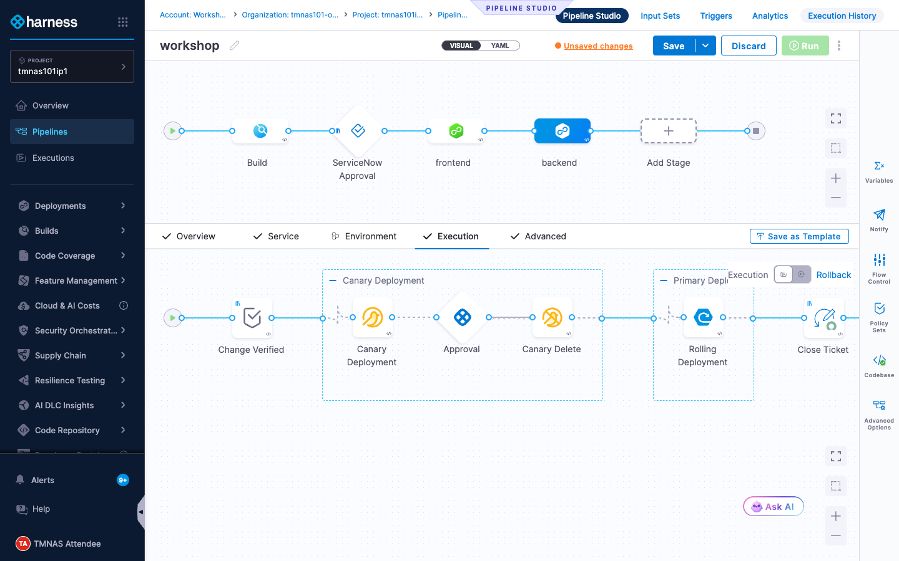

3. Click **Save**. The Production Guardrail is satisfied this time

**Run it**

1. Click **Run**, and approve the change in ServiceNow (**Implement**) as in Lab 7

2. When each deployment stage starts, click the **Change Verified** step. The logs show the policy set passed. Select the **Input** tab to see the change number, approval status, environment and service that were evaluated

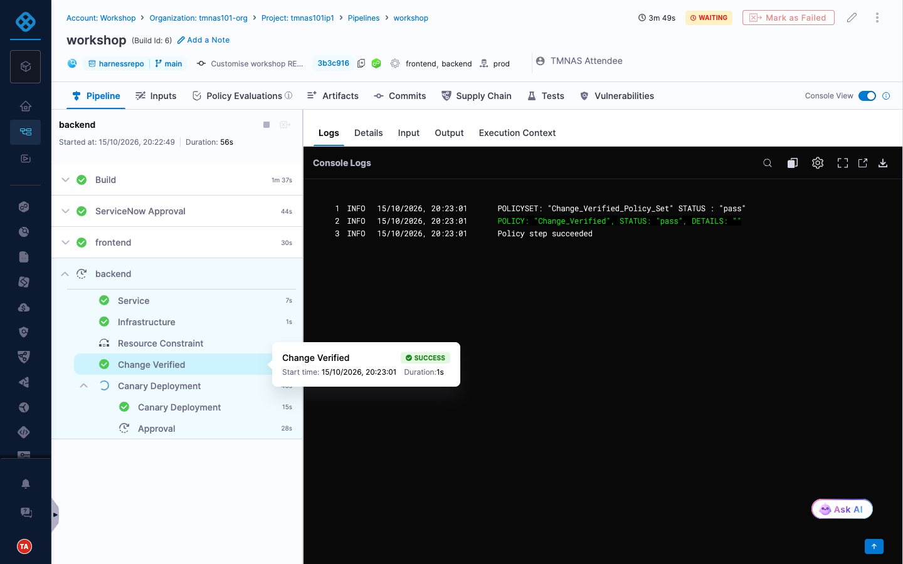

3. Approve the backend canary. The pipeline completes and **Close Ticket** closes the change

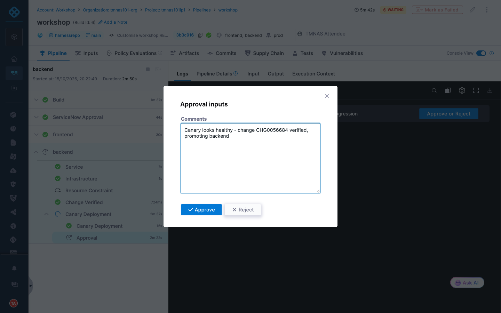


**Bonus**:
- Add `"qa"` to `protected_environments` in the Production Guardrail policy. Which of your stages would be affected?
- Open the **Policy Evaluations** tab of the execution to see every policy that was evaluated, both On Save and On Step

# Lab 9 - Enhanced Change Management Automation

### Summary: Close the loop on failed releases. Configure rollback steps that automatically update ServiceNow when a deployment fails.

**Learning Objective(s):**

- Configure rollback-specific steps in deployment stages

- Keep ServiceNow in sync with the real outcome of every release, including automated rollbacks

**Why it matters:** When an approver rejects a canary, or continuous verification or a chaos experiment triggers an automated rollback, the change record must reflect what happened. Recording failures automatically keeps change management accurate and accountable without anyone chasing tickets after an incident.

**Steps**

1. Open your pipeline in Pipeline Studio

2. Click into the **backend** stage, open **Execution** and toggle the **Rollback** view in the top right corner


3. Click the **+** after the last rollback step, select **Use template** and choose **ServiceNow Close Failed**


| Input | Value               | Notes |
| ----- | ------------------- | ----- |
| Name  |Close Failed Ticket| Sets the change to **Closed** with close code **Unsuccessful** and links the failed execution in the close notes |


4. Apply the changes and **Save** the pipeline


**Fail a release**

1. Run the pipeline and approve the change in ServiceNow as in Lab 7

2. When the backend canary is waiting for approval, click **Approve or Reject**, add a comment and click **Reject**. (If chaos is enabled in your project, you can instead let the pod-memory experiment from Lab 5 fail continuous verification.)

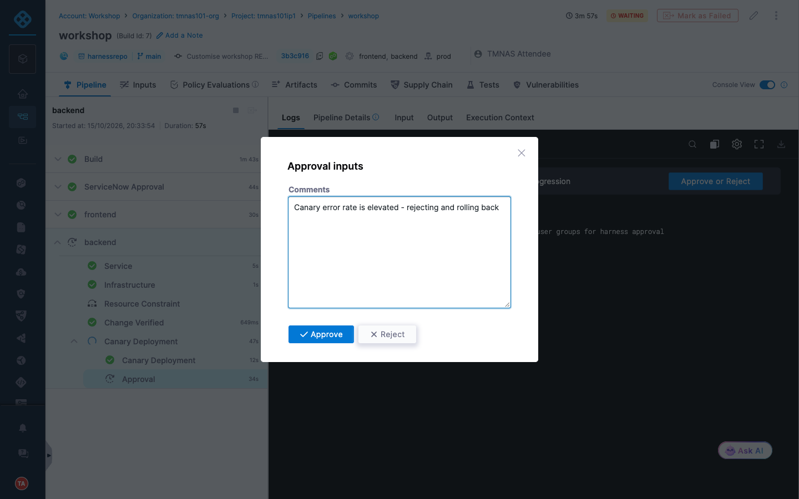

3. The backend stage failure strategy is **Rollback Stage**, so Harness runs the rollback steps: **Canary Delete**, **Rolling Rollback** and then **Close Failed Ticket**

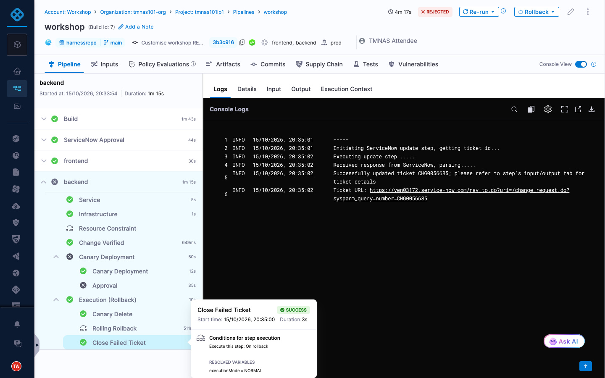

4. Open the change request in ServiceNow. It is **Closed** with close code **Unsuccessful**, and the **Closure Information** tab links to the failed execution

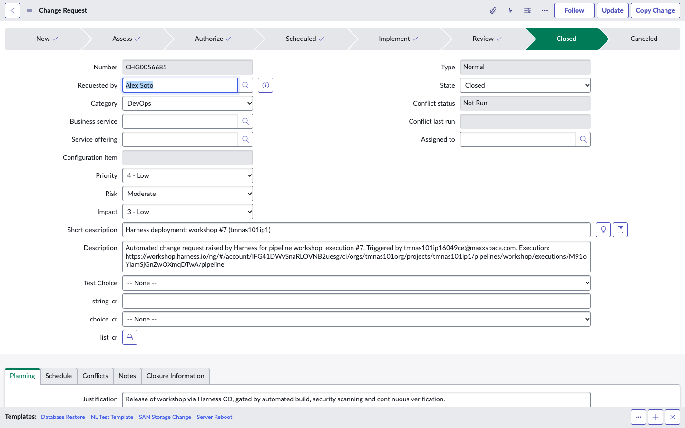
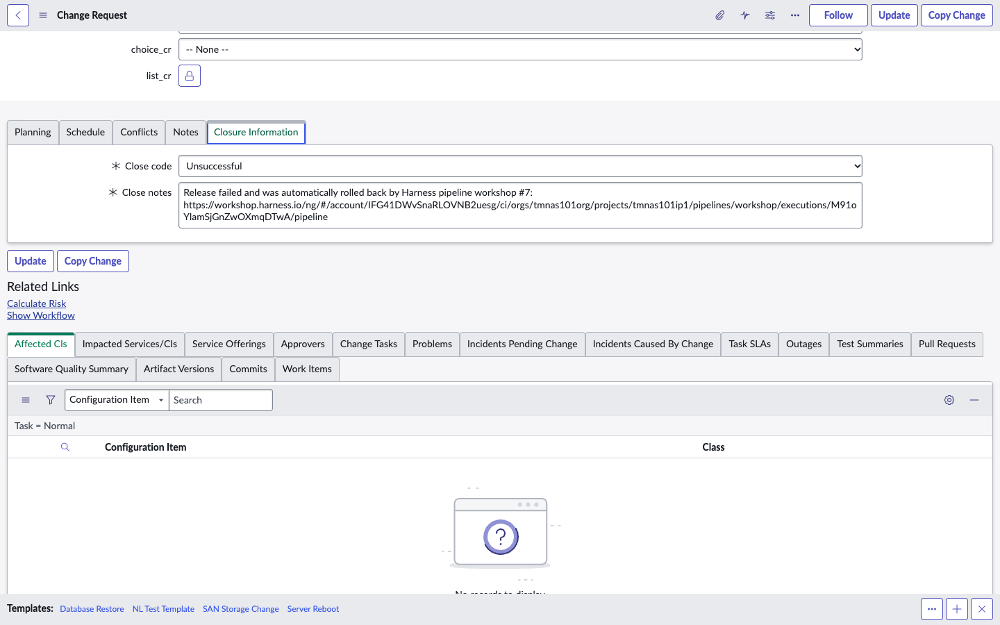

# Lab 10 - Governance/Policy as Code (Advanced)

**Create a Policy to block critical CVEs**

1. From the secondary menu, select **Project Settings** and select **Policies**

2. Select the **Policies** tab 

3. Click **+ New Policy**, set the name to **Runtime OWASP CVEs** and click **Apply**

4. Set the rego to the following and click **Save**

<!---->

    package pipeline_environment
    deny[sprintf("Node OSS Can't contain any critical vulnerability '%d'", [input.NODE_OSS_CRITICAL_COUNT])] {  
       input.NODE_OSS_CRITICAL_COUNT != 0
    }


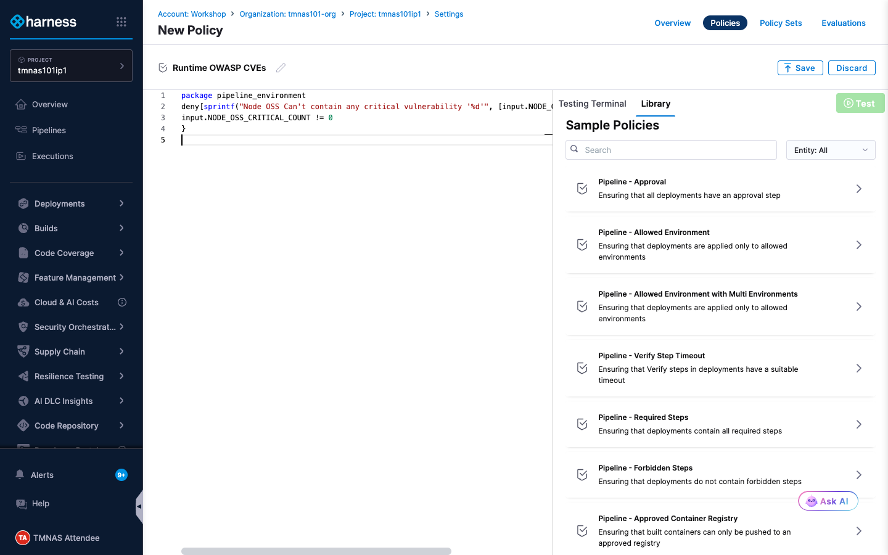

5. Select the **Policy Sets** tab

6. Click **+ New Policy Set** and configure as follows

| Input                      | Value                     | Notes |
| -------------------------- | ------------------------- | ----- |
| Name                       |Criticals Not Allowed|       |
| Entity Type                |Custom|       |
| Event Evaluation           |On Step| Set automatically when you select **Custom** |
| Policy Evaluation Criteria |                           |       |
| Policy to Evaluate         |Runtime OWASP CVEs|       |

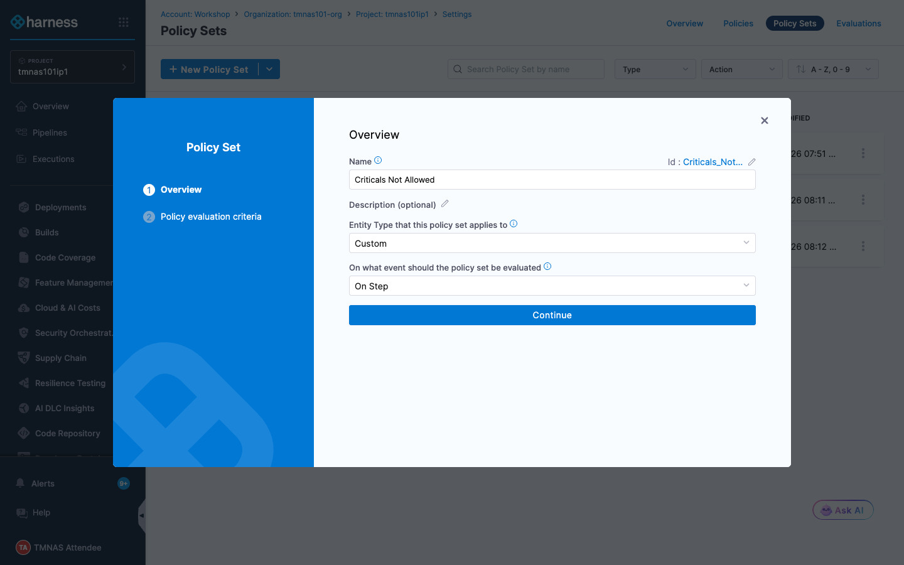
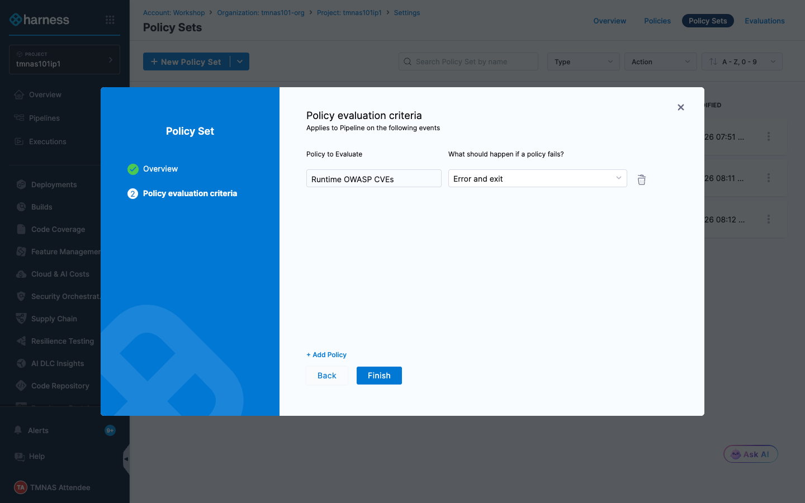

7. For the new policy set, toggle the **Enforced** button

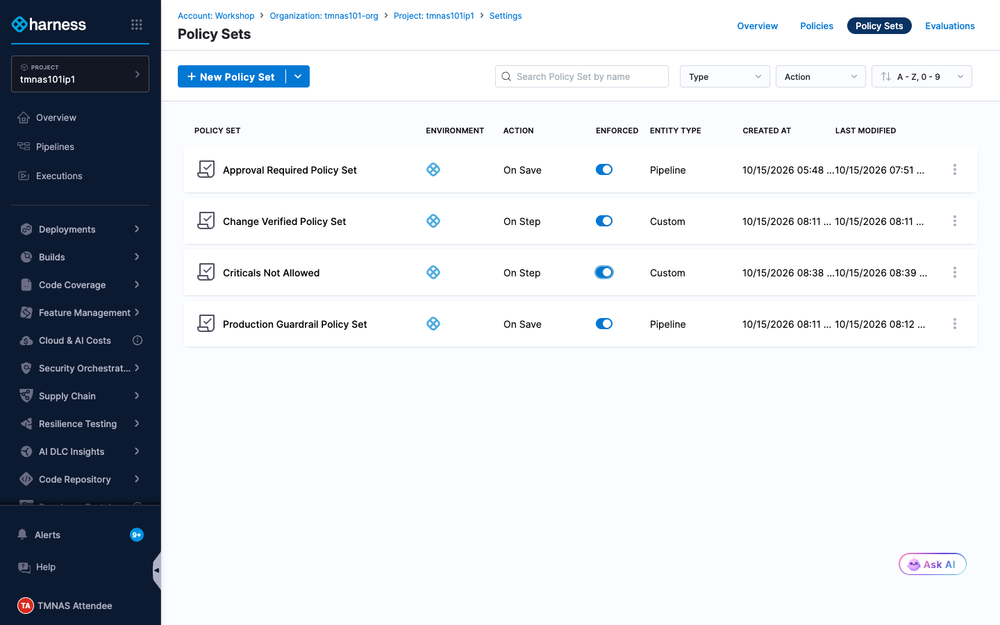

**Add Policy to Pipeline**

1. Go to an execution that already ran, open the **OWASP** step, select the **Output** tab and copy the **CRITICAL** output variable path with the copy icon:

   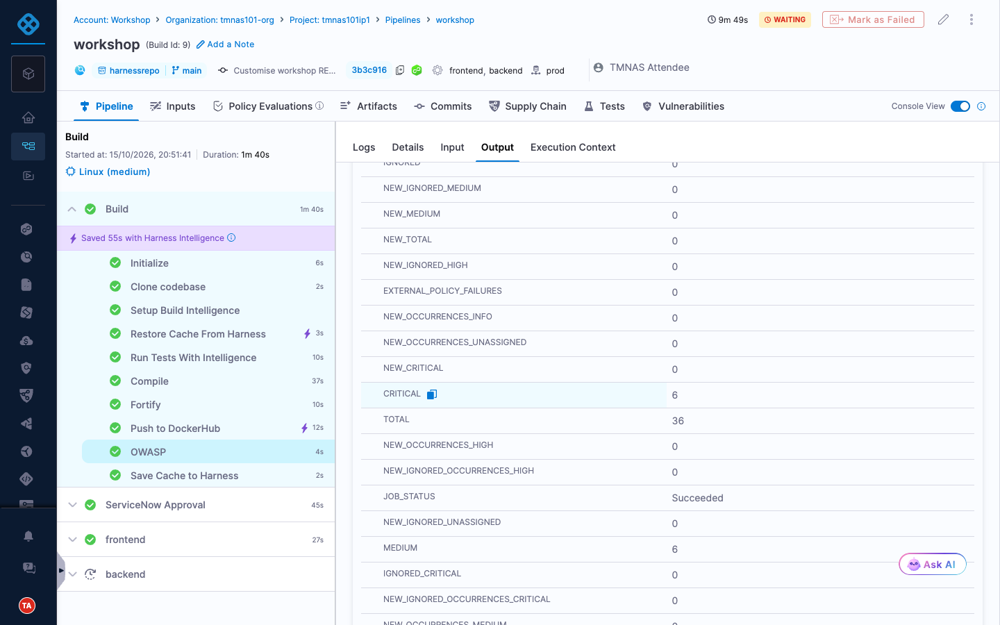

2. Open your pipeline and select the **frontend** stage

3. After the **Change Verified** step and before the **Rollout Deployment** step, add a **Policy** type step from the Step Library and configure as follows

| Input       | Value                                          | Notes                                                                                                                                                   |
| ----------- | ------------------------------------------------ | ------------------------------------------------------------------------------------------------------------------------------------------------------- |
| Name        |Policy - No Critical CVEs|                                                                                                                                                         |
| Entity Type |Custom|                                                                                                                                                         |
| Policy Set  |Criticals Not Allowed| Select the **Project** tab in the picker to see your Policy Set                                                                                     |
| Payload     |{"NODE\_OSS\_CRITICAL\_COUNT": _\<variable>_}| Replace _\<variable>_ with the CRITICAL output variable you copied, e.g. `<+pipeline.stages.Build.spec.execution.steps.OWASP.output.outputVariables.CRITICAL>` |


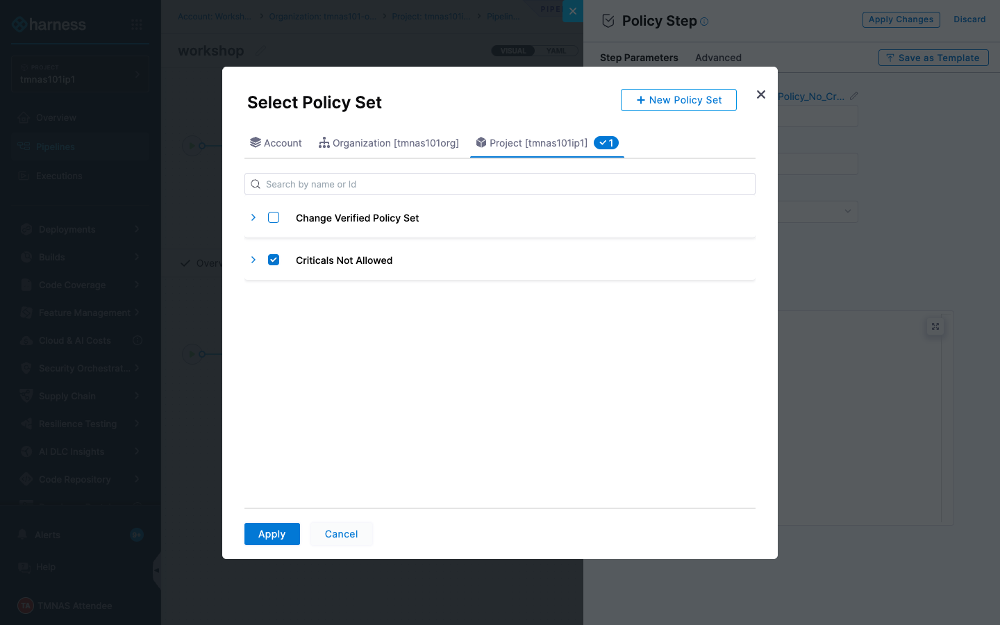
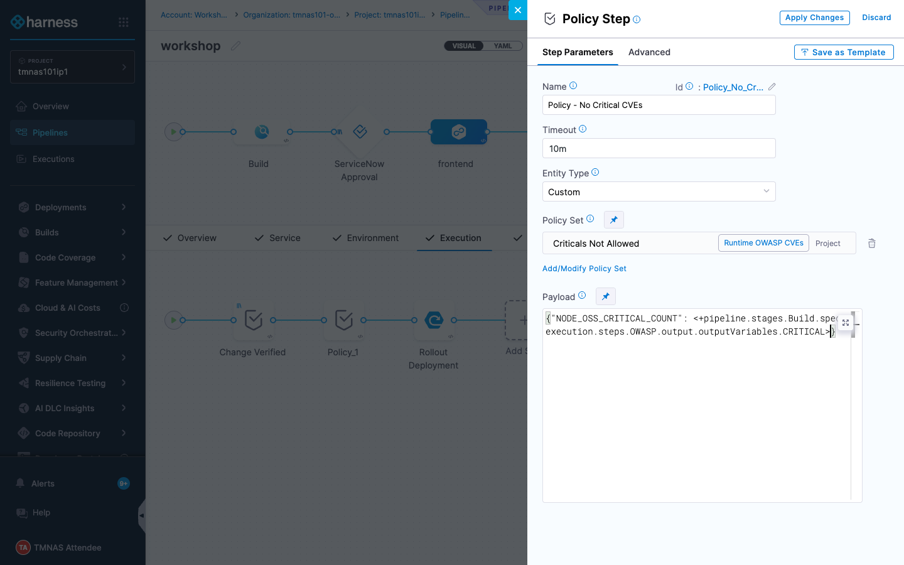
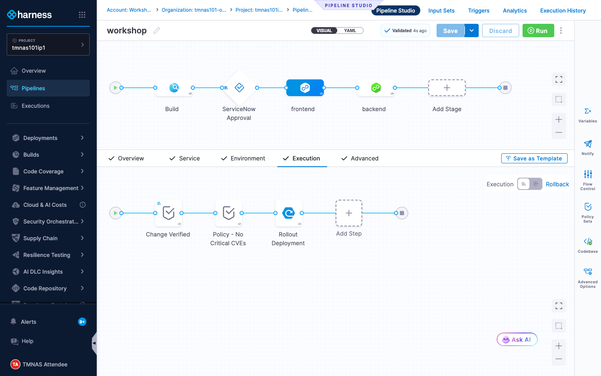

4. Save the pipeline and execute. Note that the pipeline fails at the policy evaluation step due to critical vulnerabilities being found by OWASP, and the frontend stage rolls back.

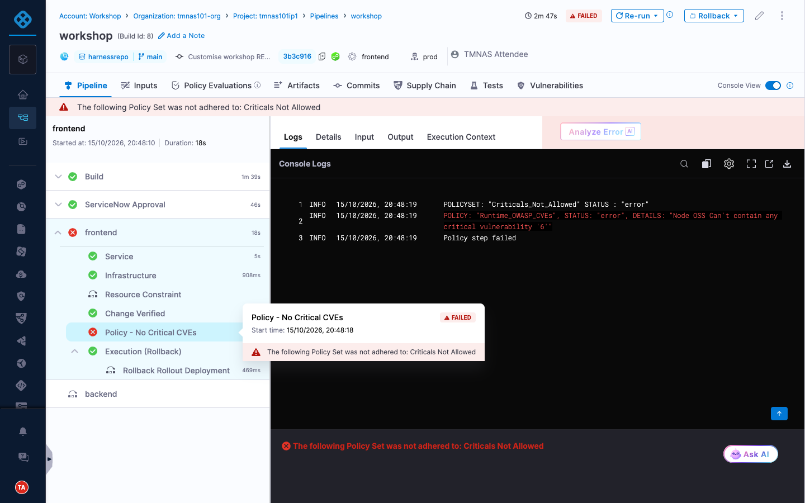

> **Tip:** the change request raised for this run stays in **Implement**. Cancel it in ServiceNow, or add the **ServiceNow Close Failed** template to the frontend rollback steps as you did for the backend in Lab 9.
