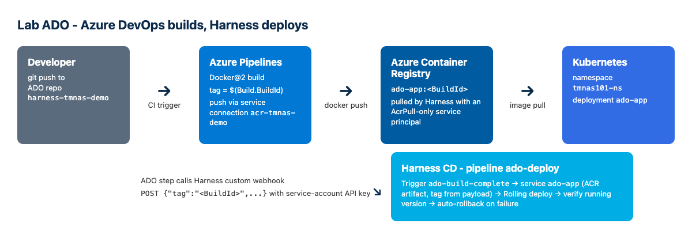
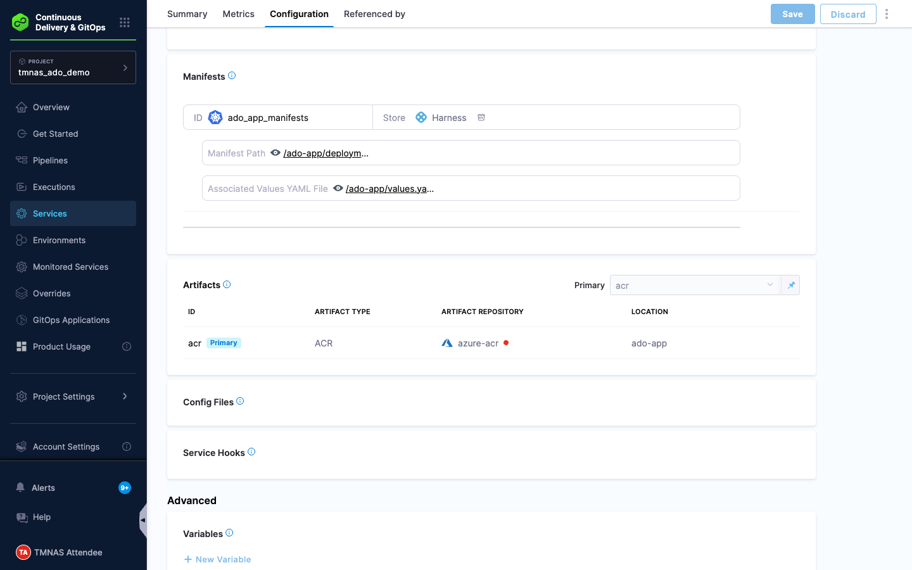
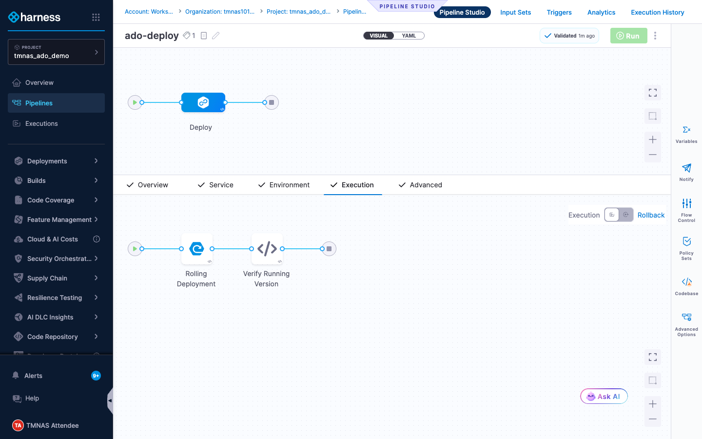
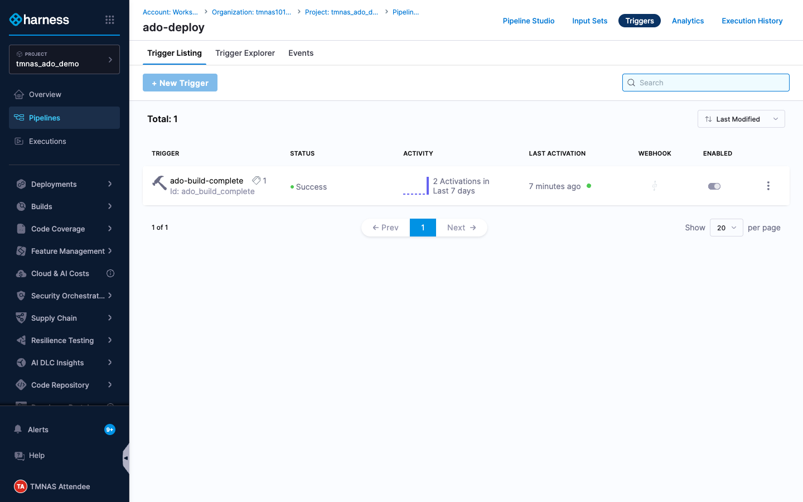
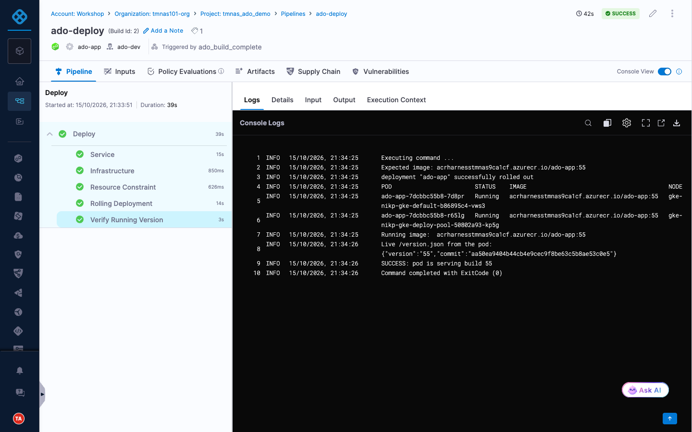

<p align="center">
  <picture>
    <source media="(prefers-color-scheme: dark)" srcset="images/tmnas-logo-white.png">
    
  </picture>
</p>

# Lab ADO - Build in Azure DevOps, Deploy with Harness CD

### Summary: Keep your existing Azure DevOps (ADO) build. Azure Pipelines builds the image and pushes it to Azure Container Registry (ACR). It then hands off to Harness, and Harness CD deploys that exact image tag to Kubernetes.

### Outcome: A commit to the ADO repo deploys automatically. The pod in Kubernetes then serves the ADO build number.



**Learning Objective(s):**

- Connect Harness to Azure Container Registry with a least-privilege service principal (AcrPull)

- Create a Kubernetes service whose ACR artifact tag is set at runtime

- Trigger a Harness pipeline from Azure Pipelines with a **Custom Webhook trigger**, passing the image tag in the payload

- Verify the running version from inside the pipeline, with automatic rollback on failure

> **Why a webhook rather than an ACR artifact trigger?** An artifact trigger polls ACR about once a minute and deploys *whatever* new tag shows up. A webhook call from the ADO pipeline gives you more:
> it runs only after the whole ADO pipeline succeeds (including any tests or scans ADO runs after the push);
> it carries the exact tag, commit and build URL, so Harness has traceability back to ADO;
> it starts immediately; and the ADO log prints the link to the Harness execution.
> The call is authenticated with a Harness service-account API key that has only the *Pipeline Executor* role in this project.

**Pre-provisioned for you**

| Item | Value | Notes |
| ---- | ----- | ----- |
| ADO organization / project | `https://dev.azure.com/mansong` / `harness-tmnas-demo` | |
| ADO repo | `harness-tmnas-demo` | `Dockerfile`, `index.html`, `azure-pipelines.yml` |
| ADO service connection | `acr-tmnas-demo` | Docker Registry, uses service principal `sp-ado-tmnas-acr-push` (AcrPush) |
| Azure Container Registry | `acrharnesstmnas9ca1cf.azurecr.io` | Repository `ado-app` |
| Harness project | `tmnas_ado_demo` (org `tmnas101org`) | |
| Harness K8s connector | `ado-demo-k8s` | Inherits from delegate `handson-workshop` |
| Harness environment / infra | `ado-dev` / `ado-gke` | Namespace `tmnas101-ns`, release `ado-app-<+infra.name>` |
| Harness File Store | `/ado-app/deployment.yaml`, `/ado-app/values.yaml` | |

---

## Part 1 - Azure DevOps: build and push to ACR

1. Open **Azure DevOps** → project **harness-tmnas-demo** → **Repos**. Look at the three files:

| File | Purpose | Notes |
| ---- | ------- | ----- |
| `Dockerfile` | nginx (unprivileged, port 8080) serving `index.html` and `/version.json` | The build stamps `VERSION=$(Build.BuildId)` into both files |
| `index.html` | Page that shows the build number | |
| `azure-pipelines.yml` | Two stages: **Build and push to ACR** (Docker@2 `build`, then Docker@2 `push`) and **Trigger Harness CD** (calls Harness) | `build` and `push` are separate tasks because Docker@2 `buildAndPush` ignores `arguments`, so the `--build-arg VERSION` would be lost |

2. Open **Project settings** → **Service connections** → **acr-tmnas-demo**

| Input | Value | Notes |
| ----- | ----- | ----- |
| Registry type | Others | |
| Docker Registry | `https://acrharnesstmnas9ca1cf.azurecr.io` | |
| Docker ID | Application (client) ID of `sp-ado-tmnas-acr-push` | This SP has only **AcrPush** on this registry |
| Password | SP client secret | |
| Grant access permission to all pipelines | Enabled | |

3. Open **Pipelines** → **ado-app-ci** → **Edit** → **Variables**

| Variable | Value | Notes |
| -------- | ----- | ----- |
| `HARNESS_WEBHOOK_URL` | Webhook URL of the Harness trigger (see Part 2, step 5) | Plain variable |
| `HARNESS_API_KEY` | Harness service-account token | **Keep this value secret**. ADO only passes it to the step through `env:` |


---

## Part 2 - Harness: service, pipeline and trigger

1. In Harness, go to **Projects** → **tmnas_ado_demo** → **Project Settings** → **Connectors** → **+ New Connector** → **Azure**

| Input | Value | Notes |
| ----- | ----- | ----- |
| Name | azure-acr | |
| Environment | Azure Global | |
| Authentication | Specify credentials here | |
| Application (Client) ID | appId of `sp-harness-tmnas-acr-pull` | AcrPull + Reader on the registry only |
| Tenant ID | your Entra tenant ID | |
| Authentication | Secret → `azure-sp-secret` | Stored in the Harness Secret Manager |
| Connect via | Harness Platform | |

> **Note:** The connector's **Test** step reports *"Failed to connect to Azure. No value present"*. This is expected. The test lists subscriptions, and this least-privilege SP can only see the registry. Click **Finish** anyway: artifact listing and image pulls work, as the execution in Part 3 shows. If you want a green test, also grant the SP **Reader** on the subscription.

2. **Services** → **+ New Service**

| Input | Value | Notes |
| ----- | ----- | ----- |
| Name | ado-app | |
| Deployment Type | Kubernetes | |
| **Add Manifest** | | |
| Manifest Type | K8s Manifest | |
| Manifest Store | Harness | |
| Manifest Identifier | ado_app_manifests | |
| Files | `/ado-app/deployment.yaml` | |
| Values.yaml | `/ado-app/values.yaml` | Holds `image: <+artifact.image>` and `dockercfg: <+artifact.imagePullSecret>` |
| **Add Artifact Source** | | |
| Artifact Repository Type | Azure Container Registry | |
| Connector | azure-acr | |
| Artifact Source Identifier | acr | |
| Subscription Id | your Azure subscription ID | |
| Registry | `acrharnesstmnas9ca1cf` | |
| Repository | ado-app | |
| Tag | Runtime input `<+input>` | The trigger fills this in |



3. **Pipelines** → **+ Create a Pipeline** → Name **ado-deploy** → **Add Stage** → **Deploy**

| Input | Value | Notes |
| ----- | ----- | ----- |
| Stage Name | Deploy | |
| Deployment Type | Kubernetes | |
| Service | ado-app | |
| Environment | ado-dev | |
| Infrastructure | ado-gke | |
| Execution Strategy | Rolling | |

4. After the **Rolling Deployment** step, add a **Shell Script** step

| Input | Value | Notes |
| ----- | ----- | ----- |
| Name | Verify Running Version | |
| Script | see below | Uses the kubeconfig Harness provides for the stage |
| Delegate Selector | handson-workshop | |

```bash
set -e
export KUBECONFIG=${HARNESS_KUBE_CONFIG_PATH}
NS=<+infra.namespace>
EXPECTED_IMAGE="<+artifact.image>"
EXPECTED_TAG="<+artifact.tag>"
kubectl -n $NS rollout status deploy/ado-app --timeout=120s
kubectl -n $NS get pods -l app=ado-app -o custom-columns=POD:.metadata.name,STATUS:.status.phase,IMAGE:.spec.containers[0].image
RUNNING=$(kubectl -n $NS get deploy ado-app -o jsonpath='{.spec.template.spec.containers[0].image}')
[ "$RUNNING" = "$EXPECTED_IMAGE" ] || { echo "Image mismatch"; exit 1; }
LIVE=$(kubectl -n $NS exec deploy/ado-app -- wget -qO- http://localhost:8080/version.json)
echo "Live /version.json from the pod: $LIVE"
echo "$LIVE" | grep -q "\"version\":\"$EXPECTED_TAG\"" || { echo "Version mismatch"; exit 1; }
```

The stage failure strategy is **Rollback Stage**. If the version check fails, Harness rolls back to the previous release automatically.



5. **Triggers** → **+ New Trigger** → **Custom** (under Webhook)

| Input | Value | Notes |
| ----- | ----- | ----- |
| Name | ado-build-complete | |
| Payload Conditions | `<+trigger.payload.repository>` Equals `ado-app` | Ignores calls for other images |
| Pipeline Input → Tag | `<+trigger.payload.tag>` | The ADO `$(Build.BuildId)` |

Click **Create**. Then click the **link icon** in the trigger list and copy the **Webhook URL**. This is the `HARNESS_WEBHOOK_URL` variable from Part 1.



---

## Part 3 - Run it end to end

1. In ADO **Repos**, edit `index.html` (for example, change the heading text) and **Commit** to `main`

2. **Pipelines** → **ado-app-ci**. The run starts automatically. Watch the two stages:

| Stage | What to look for |
| ----- | ---------------- |
| Build and push to ACR | Task **Push ado-app:&lt;BuildId&gt; to ACR** ends with `<BuildId>: digest: sha256:...` |
| Trigger Harness CD | `Trigger status: TARGET_EXECUTION_REQUESTED`, then `Harness execution: https://workshop.harness.io/ng/#/account/.../executions/<id>/pipeline` - click the link |


3. In Harness, the **ado-deploy** execution shows **Trigger: ado-build-complete**. The artifact tag equals the ADO build ID.

4. Open the **Verify Running Version** step log. It prints the pod's live `/version.json`, for example `{"version":"55","commit":"aa50ea9..."}`, followed by `SUCCESS: pod is serving build 55`

> **The check is a real guardrail.** The first run of this demo used Docker@2 `buildAndPush`, which silently dropped the build arguments. That image reported `"version":"dev"`. **Verify Running Version** failed with `Version mismatch`, and Harness rolled the stage back automatically.



---

### Troubleshooting

| Symptom | Cause | Fix |
| ------- | ----- | --- |
| ADO run fails: *No hosted parallelism has been purchased or granted* | New ADO orgs have 0 Microsoft-hosted parallel jobs | Request the free grant at https://aka.ms/azpipelines-parallelism-request (takes about 2-3 business days), or use a self-hosted agent pool |
| Trigger status `NO_MATCHING_TRIGGER_FOR_PAYLOAD_CONDITIONS` | The payload `repository` is not `ado-app` | Check the `imageRepository` variable |
| Harness: `ImagePullBackOff` | The pull secret is missing or the SP has no AcrPull | Check that `values.yaml` has `dockercfg: <+artifact.imagePullSecret>`, then run `az role assignment list --assignee <appId>` |
| Harness: `Version mismatch` in Verify Running Version | The image was built without `--build-arg VERSION` | Use separate Docker@2 `build` and `push` tasks, not `buildAndPush` |
| Azure connector test: *No value present* | The SP has no subscription-level read | Expected with a registry-scoped SP; see the note in Part 2, step 1 |
| Harness: *namespace not found* | The task ran on a delegate in another cluster | Re-run the pipeline. Check the delegate selector `handson-workshop` |
